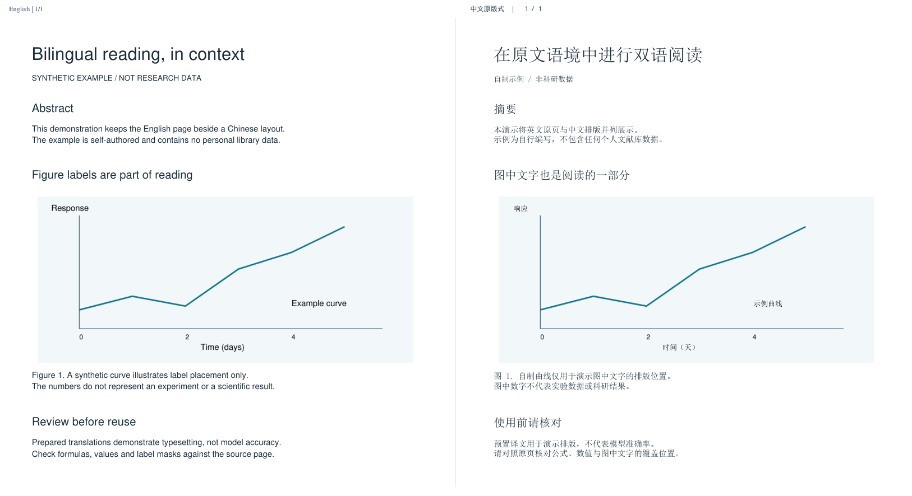

# Zotero Bilingual Reader

**在 Zotero 中生成原版式中英对照 PDF，连同图中文字一起阅读。**

[下载测试版](https://github.com/guanjunz432-ctrl/zotero-bilingual-reader/releases) · [English](README.en.md) · [安装与操作](docs/installation.md) · [隐私说明](PRIVACY.md) · [已知限制](docs/limitations.md) · [更新记录](CHANGELOG.md)

Windows 测试版 · Zotero 9 · AGPL-3.0-only · 使用你自己的 Codex 登录



> 早期预览：原型已在 Windows + Zotero 9.0.6 上处理过一篇 21 页文献。公开版进行了安装与隐私改造，验证范围见 [测试说明](docs/validation.md)。译文和图中文字定位需要人工核对；不承诺所有论文都能无误处理。

## 能做什么

- **从文献开始**：右键 Zotero 文献或英文 PDF，选择全文或指定页码。
- **左右对照**：左侧保留英文原页，右侧按原文区域放置中文译文。
- **图中文字**：尝试识别并翻译坐标轴、图例、流程框及图片中的英文；原始图形始终在左侧供核对。
- **失败可续传**：先继续后续页面，再重试失败页；重新生成会复用已完成页面。
- **自动回存**：结果作为新附件加回原文献；未完成页明确标记“中文待补”。

## 快速开始

1. 安装 **Windows 10/11、Zotero 9、Python 3.11+、Node.js 22+（含 npm）**。需要宋体、Arial 和 Segoe UI Symbol；环境检测会检查字体。
2. 从本仓库 Releases 下载后端源码 ZIP，解压到固定目录。首次使用要同时安装后端和插件，单独安装 XPI 不够。
3. 在解压目录打开 PowerShell，运行：

   ```powershell
   powershell -NoProfile -ExecutionPolicy Bypass -File .\setup.ps1
   powershell -NoProfile -ExecutionPolicy Bypass -File .\login.ps1
   ```

4. 在官方登录页面使用**自己的**账户登录。此应用使用独立的本机登录目录，不读取或复制已有 Codex 登录文件。
5. Zotero → 工具 → 插件 → 齿轮 → 从文件安装插件，选择 `dist` 中的 `.xpi`。
6. 右键一篇文献 → **Codex 中英对照 → 生成原版式中英对照（含图中文字）**。建议先输入 `1-2` 试译，完成后在原条目下打开新增附件。

详细步骤、缓存位置、升级和卸载见 [安装与操作指南](docs/installation.md)。

## 数据与费用

所选页面的文字、坐标和页面图像会交给 OpenAI 的 Codex 服务处理。PDF 解析、渲染、排版及缓存发生在本机；不下载本地模型。项目没有自建中转服务器、遥测或作者共享账号。

翻译消耗你自己的账户额度；额度、模型和可用性取决于你的账户及服务政策。开源不意味着云端调用免费或无限。官方 CLI 负责认证与令牌刷新，项目不要求提交任何登录文件。详见 [隐私说明](PRIVACY.md) 和 [官方认证说明](https://learn.chatgpt.com/docs/app-server)。

## 适合与限制

适合希望在 Zotero 中阅读英文论文、对照原图检查译文的用户。复杂表格、扫描页、密集图例、小字、旋转页面及数学上下标可能需要额外核对。图中文字覆盖框可能碰到邻近图形，中文可能缩小字号；请始终对照左侧原页。当前没有批量队列、术语库或跨平台安装承诺。

## 开发与贡献

```powershell
.venv\Scripts\python.exe scripts\test.py
node tests\test_native_bridge.cjs
.venv\Scripts\python.exe scripts\privacy_check.py
.venv\Scripts\python.exe scripts\build.py
```

欢迎提供可再分发的最小复现样例。请勿把个人论文、账户数据、登录文件或未经脱敏的日志提交到 Issues。见 [贡献指南](CONTRIBUTING.md) 和 [安全报告](SECURITY.md)。

## 许可证与致谢

本项目源码采用 **GNU AGPL v3 only**，见 [LICENSE](LICENSE)。依赖分别遵守其许可证，见 [第三方说明](THIRD_PARTY_NOTICES.md)。

- [PyMuPDF](https://github.com/pymupdf/PyMuPDF)：PDF 解析、渲染和排版。
- [Codex ACP](https://github.com/agentclientprotocol/codex-acp) 与 [OpenAI Codex](https://github.com/openai/codex)：云端模型接入。
- [Zotero PDF Translate](https://github.com/windingwind/zotero-pdf-translate)、[Zotero PDF2zh](https://github.com/guaguastandup/zotero-pdf2zh)、[Zotero Plugin Template](https://github.com/windingwind/zotero-plugin-template)：参考其安装文档、版本发布和贡献入口的组织方式。此项目未使用 PDF2zh 翻译引擎，也未宣称与这些项目存在合作。

这是独立社区项目，与 Zotero、OpenAI 及上述项目无官方隶属关系。
