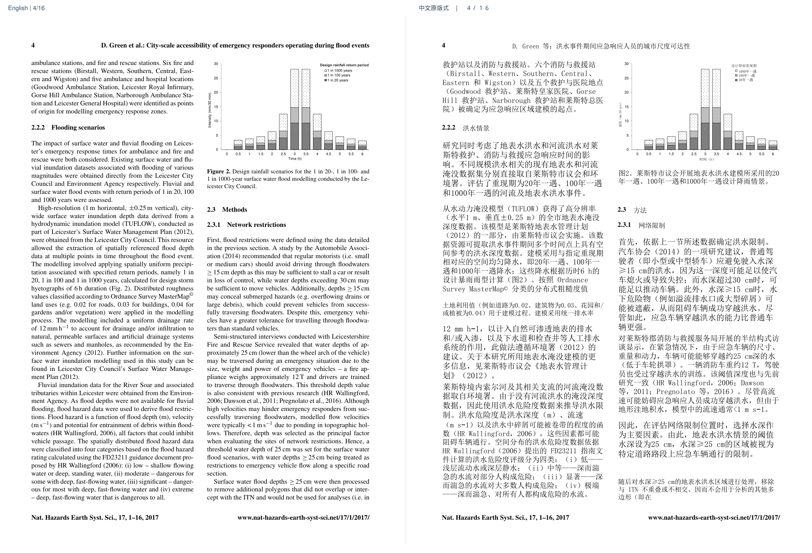
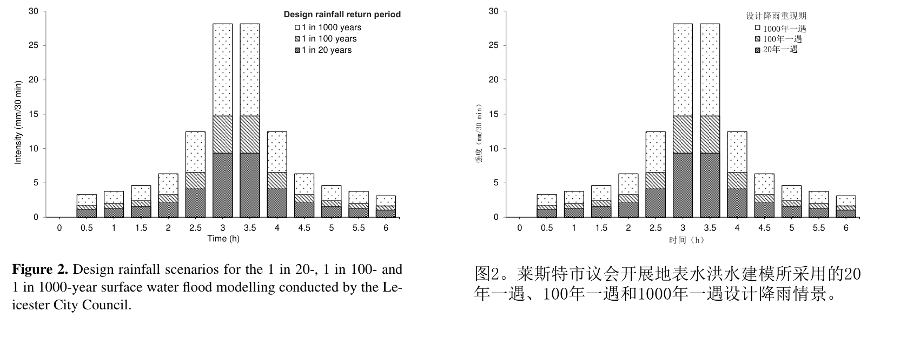

# 可用于发布页的介绍

Zotero 中英对照阅读插件更新到 0.2.0 预览版了。

选中英文论文，就能生成左边原文、右边中文的 PDF，并自动添加回原文献附件。**图也可以生成中英对照**：坐标轴、图例、图注会尝试翻译，原有数值和图形保留。

这次展示的是 Green 等（2017）论文第 4 页的真实生成结果，不是演示稿或手工改图。仓库提供整页对照图、图 2 的局部放大，以及原文第 1、4 页的两页 PDF 下载。原文按 CC BY 3.0 使用，AI 翻译与修改另有标注。

这一版还解决了逐页翻译留下大量聊天、依赖丢失只显示退出码的问题，并增加缓存复用与异常恢复。

默认普通页使用 **gpt-6-luna / low**，复杂图页或扫描页使用 **gpt-6.1-sol / low**；本机负责 PDF 解析和排版。图页分流是启发式，本例图 2 实际由 Luna 完成。

公开版这次实测普通页约 20 秒/页，复杂图页约 33 秒；3 页从开始处理到 PDF 完成共 **1 分 33 秒**，不含安装、登录及 Zotero 导入。这是少量单机样本，实际速度取决于网络、篇幅和图文复杂度。

使用自己的 Codex 账户，不提供共享账号或无限额度。密集地图、微小文字和公式仍需对照检查。当前支持 Windows 10/11 与 Zotero 9。

[仓库及安装说明](https://github.com/guanjunz432-ctrl/zotero-bilingual-reader) · [下载新版](https://github.com/guanjunz432-ctrl/zotero-bilingual-reader/releases/tag/v0.2.0-beta.1) · [实际 PDF](assets/paper-bilingual-sample.pdf) · [来源与许可](sample-provenance.md)
